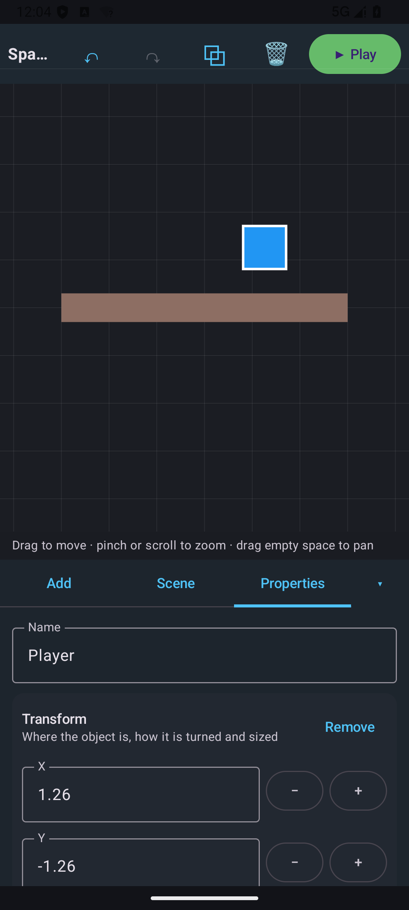

# SpawnKit builder — C3 responsive shell

Tracked by [issue #47](https://github.com/aioanei/spawnkit/issues/47). This is item C3 of the
[contest delivery track](plans/2026-11-20-engine-foundation-revision.md#contest-delivery-track), and it applies
[ADR-0007](adr/0007-mobile-builder-and-in-builder-release.md): one shared Compose builder in `app/shared`, first-class
on Android and desktop.

| Android phone (emulator, real touch input) | Desktop |
|---|---|
|  |  |

## What a creator can do

- **Start** from a functional blank project. A guided empty state invites adding objects.
- **Add objects** from a palette (Box, Circle, Platform, Player, Camera). Each preset is built only from general
  engine components; nothing is hardcoded for a genre.
- **Select** by tapping or clicking in the viewport (hit testing honours rotation, scale and ellipses), or from the
  scene hierarchy. Tapping empty space clears the selection.
- **Move** an object by dragging it. The whole drag is one undoable change. Child objects move correctly under
  rotated or scaled parents.
- **Navigate** by dragging empty space or using two fingers to pan; pinch or use the mouse wheel to zoom around the
  pointer.
- **Edit properties** in an inspector generated from component descriptors:
  - number fields with large −/+ steppers;
  - switches;
  - text fields;
  - choice chips;
  - color swatches.

  Typed values apply on Done or when focus leaves, rejected values are explained in the status bar, components can
  be added and removed, and advanced options stay hidden until requested.
- **Manage changes** with undo, redo, duplicate and delete in the toolbar.
- **Play and Stop.** Play builds an isolated world from the scene and steps it at a fixed 60 Hz. Stop returns to
  editing, and the project is never changed by playing.

## Layouts

`EditorScreen` chooses a layout by available width, not by platform:

- **Compact** (under 720 dp, phones): the toolbar, a full-width viewport, a status line, and a collapsible bottom
  panel with **Add / Scene / Properties** tabs.
- **Expanded** (tablets, desktops): the palette and hierarchy on the left, the viewport in the centre and the
  inspector on the right.

World units are density-independent (48 dp at zoom 1), so scenes look the same size on phones and desktops. The grid
keeps lines at least 32 px apart. The selection outline is 2.5 dp white, which contrasts with every swatch color.

## Verification

- **`BuilderUiTest`** (Compose UI tests on JVM) drives the real UI:
  - **Phone size (412×915):** adds Platform and Player, recolours with a swatch, and checks the viewport pixels redraw.
    It steps a position, undoes twice, then plays: it checks the world steps at 60 Hz and frames are presented. It
    stops, and confirms the project is unchanged.
  - **Desktop size (1440×900):** click selection and deselection, then a drag that moves an object exactly
    (2, 1) units as one undo step. A two-finger pinch zooms in without changing the selection, and the mouse
    wheel zooms out.
- **Android emulator** (API 36, 1080×2400): `assembleDebug`, install, launch, then real `adb input` taps and a swipe
  add objects, drag the Player and open Properties. Play shows the play view and Stop. Screenshots:
  [edit](media/android-builder-edit.png), [play](media/android-builder-play.png).
- **Other targets:** the shared UI compiles for web (Wasm). iOS compiles in CI. No physical-device or iOS-device run
  is claimed.

## Not yet

- Rules and behaviors (C4).
- Saving and opening projects (C5).
- Release and Arcade (C6).
- AI Studio (C7).
- Multi-select and rotate/resize handles.
- Scene switching UI and copy/paste.
- The emulator run used single-finger input. Two-finger pinch and mouse-wheel zoom are verified by the desktop UI
  test, including that a pinch never selects or moves objects.
