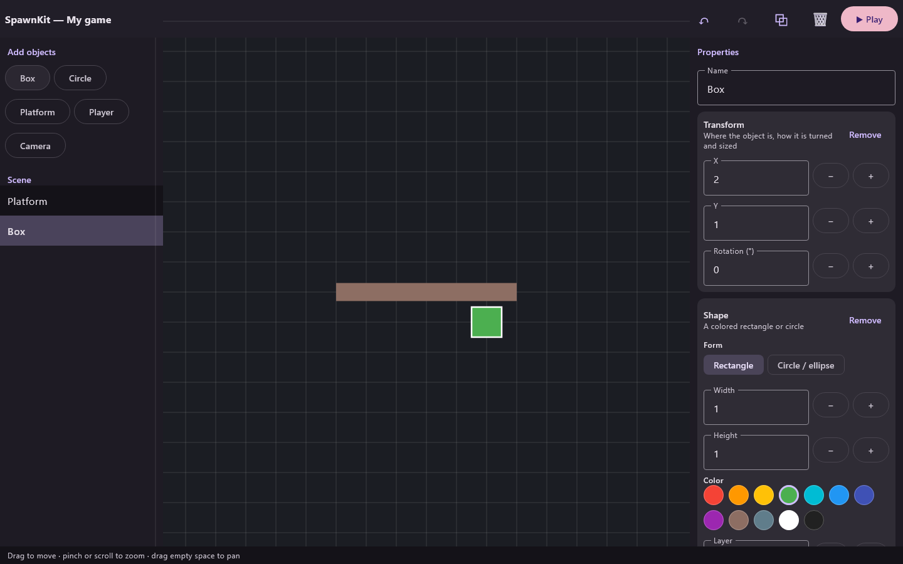
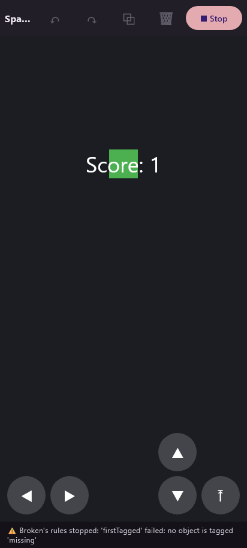
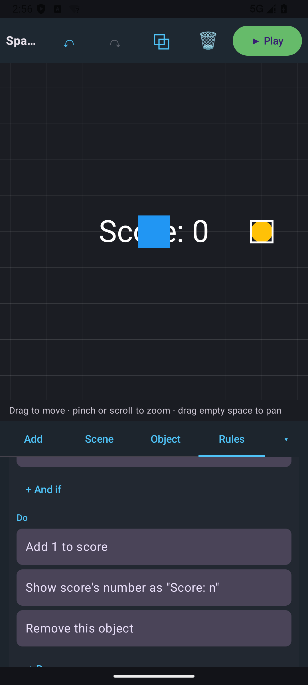
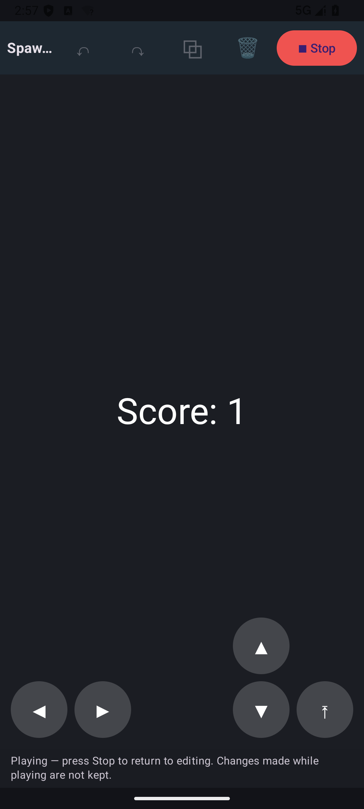
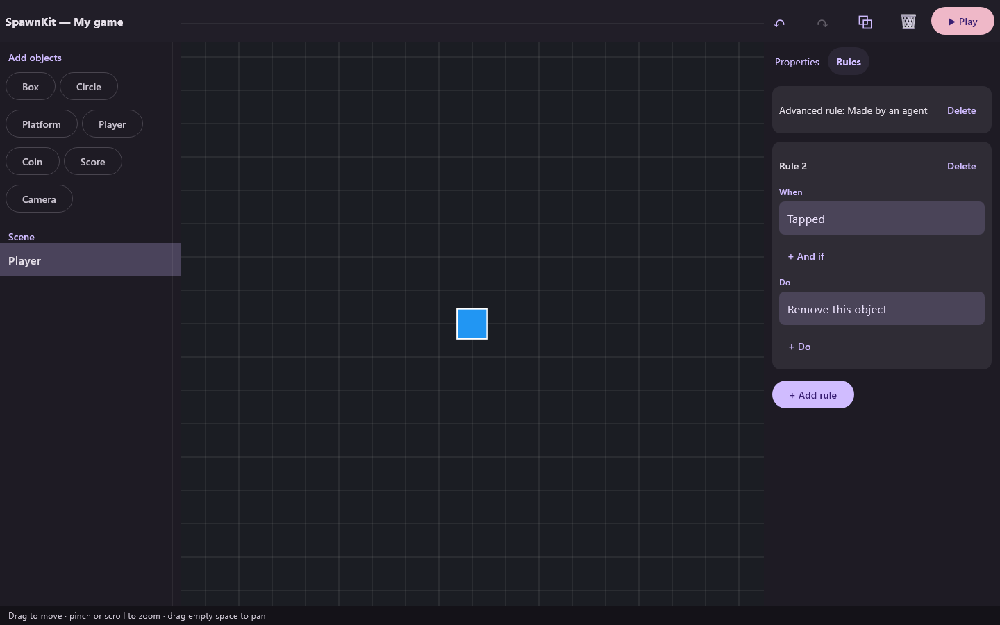

# SpawnKit builder — C3 responsive shell

Tracked by [issue #47](https://github.com/aioanei/spawnkit/issues/47). This is item C3 of the
[contest delivery track](plans/2026-11-20-engine-foundation-revision.md#contest-delivery-track), and it applies
[ADR-0007](adr/0007-mobile-builder-and-in-builder-release.md): one shared Compose builder in `app/shared`, first-class
on Android and desktop.

| Android phone (emulator, real touch input) | Desktop |
|---|---|
|  |  |

## What a creator can do

- **Start** from a functional blank project. A guided empty state invites adding objects.
- **Add objects** from a palette (Box, Circle, Platform, Player, Camera). Each preset is built only from general
  engine components; nothing is hardcoded for a genre. The builder runs the same `StandardEngine` as exported
  players ([gameplay](gameplay.md)), so Text, Tag and Number components can be added from the inspector.
- **Select** by tapping or clicking in the viewport (hit testing honours rotation, scale and ellipses), or from the
  scene hierarchy. Tapping empty space clears the selection.
- **Move** an object by dragging it. The whole drag is one undoable change. Child objects move correctly under
  rotated or scaled parents.
- **Navigate** by dragging empty space or using two fingers to pan; pinch or use the mouse wheel to zoom around the
  pointer.
- **Edit properties** in an inspector generated from component descriptors:
  - number fields with large −/+ steppers;
  - switches;
  - text fields;
  - choice chips;
  - color swatches.

  Typed values apply on Done or when focus leaves. A rejected value (for example a negative width, or text in a
  number field) stays in the field with a plain-language explanation under it, and the project is unchanged.
  Components can be added and removed, and advanced options stay hidden until requested.
- **Manage changes** with undo, redo, duplicate and delete in the toolbar.
- **Use the keyboard.** The scene has keyboard focus when the builder opens and whenever it is touched or clicked,
  and while play starts or stops. Ctrl and Cmd are interchangeable:

  | Keys | Action |
  |---|---|
  | Ctrl+Z | Undo |
  | Ctrl+Shift+Z or Ctrl+Y | Redo |
  | Ctrl+D | Duplicate the selection |
  | Delete or Backspace | Delete the selection |
  | Arrows (Shift+arrows) | Nudge the selection by 0.1 (1) units, one undo step each |
  | Escape | Clear the selection, or stop play |

  Shortcuts only apply while the scene has focus, so typing in an inspector field never moves or deletes objects.
  Other controls are reachable with Tab, as Compose provides.
- **Play with rules and input (C4b).** Objects' rules run while playing. The player controls the game with:
  - the keyboard: arrows or WASD hold left/right/up/down, and Space holds jump;
  - taps and clicks, converted to world units through the camera so rules can use `tapped()`. A press and release
    between two ticks still reaches the rules exactly once;
  - on-screen hold-to-press controls on compact (phone) layouts.

  If a rule stops, the status bar names the object and explains why. Objects whose rules have problems play without
  them, and the status bar says so.

  
- **Make rules without code (C4c).** Select an object and open **Rules** (a tab on phones, a panel switch on
  desktops). Each rule is a card: **When** a block, optional **And if** blocks, and **Do** blocks.
  - **Editing blocks.** Tap a block to change it, or tap **+ Add rule**, **+ And if** or **+ Do** to add one. A dialog
    offers large chips for the kind of block and its choices: tags that exist in the scene, keys, directions,
    comparisons, "this object" or a tagged object. Numbers use −/+ steppers, so rules can be built without a keyboard.
    Actions can set plain text or show a number after a prefix, such as "Score: ". Timer periods range from one
    second to one day; controls stop at the supported limits.
  - **Undo, problems and advanced rules.** Every change is one undoable step. Problems found when checking the rules
    appear in red under the block they belong to. Rules made by agents or other tools that are not blocks appear as
    advanced rules and are never changed.
  - **Presets.** Player (tagged `player`), Coin (tagged `coin`) and Score (a "Score: 0" label with a number, tagged
    `score`) make a first game quick.

  | Android emulator: rules built with taps | Android emulator: playing |
  |---|---|
  |  |  |

  Expanded desktop layout, including an advanced rule preserved alongside a block rule:

  
- **Play and Stop.** Play builds an isolated world from the scene and steps it at a fixed 60 Hz. Stop returns to
  editing, and the project is never changed by playing.

## Layouts

`EditorScreen` chooses a layout by available width, not by platform:

- **Compact** (under 720 dp, phones): the toolbar, a full-width viewport, a status line, and a collapsible bottom
  panel with **Add / Scene / Object / Rules** tabs.
- **Expanded** (tablets, desktops): the palette and hierarchy on the left, the viewport in the centre and the
  inspector on the right.

World units are density-independent (48 dp at zoom 1), so scenes look the same size on phones and desktops. The grid
keeps lines at least 32 px apart. The selection outline is 2.5 dp white, which contrasts with every swatch color.

## Verification

- **`BuilderUiTest`** (Compose UI tests on JVM) drives the real UI:
  - **Phone size (412×915):** adds Platform and Player, recolours with a swatch, and checks the viewport pixels redraw.
    It steps a position, undoes twice, then plays: it checks the world steps at 60 Hz and frames are presented. It
    stops, and confirms the project is unchanged.
  - **Desktop size (1440×900):** click selection and deselection, then a drag that moves an object exactly
    (2, 1) units as one undo step. A two-finger pinch zooms in without changing the selection, and the mouse
    wheel zooms out.
  - **Inline validation (desktop size):** a negative width and a non-number each show an explanation under the field
    and leave the project unchanged; a valid value clears it and applies.
  - **`PlayRulesUiTest`** plays projects whose rules were set through editor operations:
    - holding Right on the keyboard moves the player into a coin, which updates the score label and disappears;
    - a quick tap on an object is seen by its rules exactly once, and taps elsewhere are not;
    - at phone size, holding the on-screen Right control collects the coin, and a faulting rule's object and reason
      appear in the status bar.
  - **`RuleEditorUiTest`:**
    - At phone size, a Score + collect game is built with taps only: presets, inspector steppers, and the rule
      dialog for both the player and the coin. It then checks undo/redo of a block, plays, and holds the on-screen
      Right control until the label reads "Score: 1".
    - At desktop size, it changes a When block, adds an And if, removes a Do block and deletes a block rule, while
      an advanced rule is kept.
    - At phone size, it edits a plain-text action and checks that a timer at one day cannot be increased.
  - **Keyboard (desktop size):** arrow and Shift+arrow nudges, Ctrl+D, Delete, Ctrl+Z, Ctrl+Shift+Z, Ctrl+Y,
    Escape to deselect and Escape to stop play.
- **Android emulator** (API 36, 1080×2400): `assembleDebug`, install, launch, then real `adb input` taps and a swipe
  add objects, drag the Player and open Properties. Play shows the play view and Stop. Screenshots:
  [edit](media/android-builder-edit.png), [play](media/android-builder-play.png).
- **Android emulator, rules (C4c):** `tools/android-rules-smoke.py` drives the installed app on a running emulator with
  real `adb` taps. It builds the Score + collect rules through the Rules tab, plays, and holds the on-screen Right
  control; the play screenshot shows "Score: 1".
- **Other targets:** the shared UI compiles for web (Wasm). iOS compiles in CI. No physical-device or iOS-device run
  is claimed.

## Not yet

- More blocks (spawning, sounds, scene changes, variables) and reordering rules or blocks by dragging.
- Saving and opening projects (C5).
- Release and Arcade (C6).
- AI Studio (C7).
- Multi-select and rotate/resize handles.
- Scene switching UI and copy/paste.
- Horizontal-only trackpad scrolling is ignored rather than panning the scene.
- The emulator run used single-finger input. Two-finger pinch and mouse-wheel zoom are verified by the desktop UI
  test, including that a pinch never selects or moves objects.
