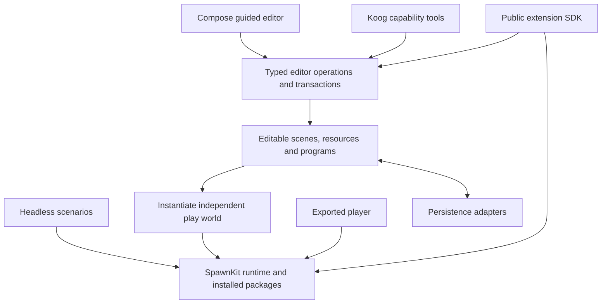

# Engine alternatives and architecture reassessment

Status: **reviewed and merged by the owner** (PR #25). Written 2026-11-20 at baseline `ff86bd0`; later R1 work followed its split (storage comparison in R1c, program executor in R1d), so the "remaining" items below describe that baseline, not today. Original status: proposal for review. This reassesses the accepted [general-purpose direction](2026-11-20-general-purpose-engine.md) against the owner's renewed request to revise the plan before implementation. It preserves the accepted product requirements and merged work. Recommendations below do not select dependencies or authorize more implementation.

## 1. What is established and what remains a choice

The objective is a SpawnKit-owned, extensible KMP 2D engine, integrated with a Compose Multiplatform visual editor, Koog agents and Ktor services. No-code creation, custom gameplay, publishing, monetization and the marketplace remain requirements. Unity and Godot are references for breadth and workflow, not a promise of immediate feature parity.

At review baseline `ff86bd0`, R1a and R1b are merged. `core/runtime` can create player-free worlds, register external Kotlin components/systems, schedule updates and checkpoint declared native state. It does not depend on `core/model` or a JSON decoder. `samples/runtimeProbe` is a separately compiled consumer. These establish useful boundaries; they do not establish a production storage choice, portable program executor, complete extension SDK or visual editor.

The legacy platformer still uses a sealed component list, a compiler requiring exactly one `PlayerController`, and a `GameSession` calling fixed gameplay systems. Changing its file format would leave those restrictions intact. Preserve it for compatibility and migrate its mechanics into a public-SDK demonstration package.

Separate these decisions:

| Decision | Constraint | Remaining choice |
|---|---|---|
| Engine ownership | SpawnKit owns public runtime, behavior, editor and extension contracts | Focused libraries behind those boundaries |
| Creator model | Visual composition and programmable logic; no genre vocabulary limit | Particular controls and later graph layout |
| Runtime organization | Open types, explicit execution/lifecycle, headless operation | Storage layout and optimizations |
| Creator program execution | Same semantics in editor, validation and exports; bounded execution | Common interpreter versus a qualifying embedded runtime |
| Persistence | Independent adapters and deliberate migrations | Authoring codecs, browser repository and prepared export encoding |

Selection first checks required targets, headless operation, extensibility, state/failure semantics and license. Only candidates passing those checks need performance comparison. Among survivors, prefer measured suitability, clear debugging, maintainable integration and the smaller dependency/build burden. Existing implementation effort is evidence, not a reason to retain an unsuitable design. No deadline or unsupported performance score settles the choice.

## 2. Runtime and authoring alternatives

These judgments are engineering inferences for SpawnKit. The cited engines demonstrate techniques; none proves SpawnKit compatibility. The options can overlap: scene hierarchy can be represented by ECS relationships, and an ECS can have a friendly visual editor. The decision concerns public semantics and coupling, not whether one pattern name excludes another.

| Alternative | Why it is credible | Main tradeoff | Recommendation |
|---|---|---|---|
| Scene tree with object callbacks | Natural visual hierarchy and reusable objects | Traversal, lifecycle and callback order can couple behavior to hierarchy | Retain scene composition; make execution order explicit rather than implicit in the tree |
| Pure ECS exposed throughout authoring | Open data types, queries and bulk processing | Storage/query concepts alone do not supply approachable tools, programs, resources or editor transactions | Evaluate ECS storage internally; do not require creators to reason about it |
| Scene/component authoring with a scheduled runtime | Hierarchy and reusable scenes for authors; explicit processing and replaceable storage for execution | Needs stable authoring-to-instance identity and two clearly separated state lifetimes | **Best fit for the accepted requirements**, subject to remaining R1 proofs |
| Immutable state plus event reducers as the entire runtime | Explicit state transitions and convenient history | Copying and event replay costs need measurement; external mutable extension state needs additional contracts | Use transactions/history where valuable in authoring; do not impose whole-world immutability or event sourcing on simulation |
| Wrapper around an existing complete engine | Reuses a mature runtime and platform stack | Moves foundation ownership outside the accepted SpawnKit boundary | Excluded by the ownership requirement; assess independent supporting libraries where useful |
| Expanded configuration compiler | Reuses the current platformer path | A growing list of mechanics remains the gate on expressiveness | Reject as the general engine architecture |

Godot describes reusable scenes and explicitly distinguishes tree relationships from spatial relationships. This supports scene authoring without requiring a Godot-style runtime. Unity Entities distinguishes entity identity, component data and system processing; that is useful storage/execution precedent without requiring Unity's authoring model. [Godot scene organization](https://docs.godotengine.org/en/stable/tutorials/best_practices/scene_organization.html), [Unity ECS concepts](https://docs.unity3d.com/Packages/com.unity.entities@1.3/manual/concepts-intro.html).

Recommendation: retain scene/component authoring over the provisional scheduled-runtime boundary. Do not freeze storage, callback APIs, class names or module locations from the word “hybrid.” Hierarchy expresses composition; the schedule expresses processing dependencies. Authoring IDs identify editable definitions; runtime handles identify particular instances. Two instances of a scene must have independent mutable state.

### Storage shortlist

Compare the existing simple store with a pinned Fleks candidate through the same SpawnKit-facing lifecycle/query/checkpoint fixtures. Fleks is a focused MIT ECS rather than a complete engine. Its 2.16 Native conventions comment out iOS declarations; its web conventions declare `wasmJs` without a `js` declaration. This is a concrete target-compatibility question, not proof that every version or source integration fails. Verify published artifacts and any proposed adaptation before benchmarking. [Fleks repository](https://github.com/Quillraven/Fleks), [2.16 license](https://github.com/Quillraven/Fleks/blob/2.16/LICENSE), [Native conventions](https://github.com/Quillraven/Fleks/blob/2.16/build-logic/src/main/kotlin/fleks/kmp-native.gradle.kts), [web conventions](https://github.com/Quillraven/Fleks/blob/2.16/build-logic/src/main/kotlin/fleks/kmp-js.gradle.kts).

Measure create/destroy, attach/remove, query churn and steady updates at small, medium and larger scene sizes; include allocations, capture/restore cost and fingerprint equivalence. Record versions, hardware, warm-up, commands and results. Require stable observable ordering regardless of internal iteration. Published library benchmarks are not SpawnKit results. If a candidate needs a maintained fork or extra target artifacts, include that ownership cost explicitly; do not drop a required target to adopt it.

## 3. Custom logic alternatives

A form catalog of Jump, Collect and Win behaviors cannot satisfy the goal on its own. Creators need state, values, records/collections, functions, conditions, iteration, custom events, timers, queries and calls into installed capabilities. Ready-made behaviors are editable conveniences on those primitives. Developers additionally need typed KMP components, systems and services outside the creator language.

| Execution option | Primary-source evidence | Unresolved SpawnKit work | Disposition |
|---|---|---|---|
| Typed program representation interpreted in common Kotlin | We control instructions, state, metering and bindings; no additional VM is inherent in this approach | Implement/type-check/debug a language core, continuations, atomic effects and portable semantics | Leading candidate; prove a small executable slice before building a full language |
| Embedded Lua | Lua provides a C embedding API, coroutines and instruction-count hooks | KMP bindings/artifacts across all targets, typed editor bindings, complete state/continuation capture and effect rollback | Credible comparison candidate; C portability alone is insufficient |
| Embedded JavaScript, such as QuickJS | QuickJS exposes memory/stack limits and an interrupt handler | Target adapters, deterministic charging, typed bindings and recoverable continuation/state semantics | Credible comparison candidate; interruption alone does not prove rollback or replay |
| Guest Wasm modules | Wasmtime documents fuel-based deterministic interruption | A qualifying host on every target, including web, plus ABI, debugging, state capture and effect semantics | Evaluate deployment feasibility first; a Kotlin/Wasm player does not itself provide an embedded guest runtime |
| Kotlin custom scripting as universal creator execution | Kotlin documents an experimental JVM scripting host | No demonstrated common JVM/JS/Wasm/Native executor or safe bounded execution | Exclude this host as the universal solution; retain compiled Kotlin for the developer SDK |

Evidence: [Lua manual](https://www.lua.org/manual/5.4/manual.html#4.7), [QuickJS embedding and limits](https://bellard.org/quickjs/quickjs.html), [Wasmtime fuel configuration](https://docs.rs/wasmtime/latest/wasmtime/struct.Config.html#method.consume_fuel), [Kotlin scripting host](https://kotlinlang.org/docs/custom-script-deps-tutorial.html). These describe facilities, not tested SpawnKit integrations. Kotlin's documented JavaScript interoperation applies to its web target and is not evidence of one embedded JavaScript runtime on all platforms. [Kotlin/Wasm interoperation](https://kotlinlang.org/docs/wasm-js-interop.html).

Recommendation: pursue one portable executable program model, with guided When / If / Do rules first and advanced graphs later. Favor the common Kotlin interpreter if no embedded candidate passes the required contracts with a maintainable integration. An embedded runtime can win on evidence; the comparison must not be written to guarantee the custom interpreter wins. A frontend may lower into an implementation representation, but user programs must not become a finite set of genre configurations. A future textual frontend is optional.

Use the same comparison fixture: a user function iterates queried objects, calculates a result using user state/collections, emits a custom event, yields on a timer and resumes. Capture before/after the yield; restore/replay must match. Inject a type error, runaway loop, recursion, allocation growth and a failing host call. Show source-level diagnostics and deterministic resource charges. Screen candidates using documents/artifacts first; prototype only survivors, with small common fixtures rather than multiple complete runtimes.

Atomic segments commit on handler return or explicit yield, with reads seeing buffered writes; faults discard that segment's state/world writes, messages and effect requests. Previous committed segments remain. Native SDK code stays trusted and fail-stop; the existing R1b checkpoint API does not make arbitrary Kotlin callbacks preemptible or transactional. Instruction limits cannot bound an unbounded host callback. A host watchdog abort is inconclusive and must not become a deterministic game outcome.

## 4. Engine, editor and extension boundary

The workspace is a meaningful editable object model even when never saved. The runtime accepts typed construction and installed behaviors even when no workspace exists. Persistence encodes these objects at a boundary. Shared contracts do not require every simulation update to invoke an editor command or string-based tool dispatcher.

Descriptors associate executable type/function/event signatures with friendly labels, defaults, constraints, help and reference pickers. They generate baseline property/behavior controls for installed packages. Serialization metadata may assist a codec but cannot be the sole capability registry. Tools also declare effects and availability: an in-game behavior does not inherit package installation, file access or publishing rights from the editor.

Koog adapters discover and call these operations, stage changes against a workspace revision, run the real engine and propose a reviewable transaction. Human acceptance commits it with undo; cancellation/rejection discards it. A flat generation spec is one optional tool input. Koog's class-based tools support the adapter surface; they do not replace editor implementation or validation. [Koog class-based tools](https://docs.koog.ai/tools/class-based-tools/).

First-party gameplay packages and separately compiled consumers use the same public registration path. Bevy demonstrates compiled third-party plugins as ordinary dependencies; this is precedent for a genuine extension SDK without universal binary hot-loading. [Bevy plugins](https://bevy.org/learn/quick-start/getting-started/plugins/).

Marketplace categories remain content, portable logic, compiled runtime extensions and editor extensions. Compiled KMP packages initially require compatible creator/player builds for their declared targets. Lock package versions/hashes; record SDK/program/resource compatibility, migrations, license and provenance. A universal player runs only installed capabilities. An absent package remains identifiable and losslessly preserved in authoring, while execution/export is blocked with a useful diagnostic. Signatures establish integrity, not a native-code sandbox.

## 5. Persistence decisions follow capability decisions

Keep three concerns separate:

| Concern | Required behavior | Proposed starting point |
|---|---|---|
| Editable project persistence | Independent resources, stable references, migrations, diffability, autosave/recovery | Directory/manifest/resource repository; readable codecs where useful; browser adapter with explicit limits |
| Runtime checkpoint/replay | Capture all declared execution state and restore equivalent independent worlds | Retain R1b's runtime-scoped in-memory checkpoints; design persisted/versioned checkpoints only when needed |
| Distribution/build output | Exact packages/assets/programs and reproducible target builds | Locked manifest plus prepared resources, with encoding chosen independently of authoring |

JSON is eligible for readable resources and transport; TOML/YAML do not change expressiveness. SQLite merits evaluation for transactional/indexing needs, and binary formats for measured loading/size needs. No winner needs to be selected before the executable contracts are proven. In particular, R1b's `StateValue` checkpoint representation must not grow into a mandatory schema for all engine execution or editor capabilities. Ordinary typed runtime use already permits execution without a checkpoint codec.

Preserve v1 JSON decoding and fixtures as an explicit legacy adapter. Test migration, unsupported packages and interrupted saves without data loss. Store-policy and payment-provider details remain separate launch reviews; changing an encoding cannot establish distribution compliance. This review adds no platform-policy or legal conclusions.

## 6. Proofs, delivery impact and retained scope

Continue the existing R0–R9 sequence after review, from the merged checkpoint. Complete R1's storage comparison and program/effect proofs before broad R2 work. Define operations/metadata alongside that boundary; build the small real editor/program loop at R4, deepen persistence and SDK authoring at R5, then migrate demonstrations and players at R6. Koog at R7 consumes working operations; R8 adds publishing/export/commercial service seams; R9 requires technical and novice-usability evidence.

In addition to the existing [six proofs and novice gate](2026-11-20-general-purpose-engine.md#10-proof-of-the-architecture), require this migration evidence:

| Proof | Evidence needed |
|---|---|
| Platformer is a consumer | Demo imports only public SDK/facility APIs; generic modules import no demo or legacy gameplay types |
| Gameplay vocabulary stays open | Top-down puzzle/action and UI/economy demos run on the same engine API revision; unfamiliar mechanics use ordinary programs or external packages |
| Extensions are usable everywhere promised | Separate consumer adds state, behavior and operation; generated inspector/rule controls, undo, Koog use, headless execution and declared exports work |
| Serialization stays peripheral | Direct construction/edit/run works before saving; save/reload and legacy import are verified separately |
| Execution is real | Preview, headless validation and exports resolve the same locked runtime packages and prepared programs; no alternate simplified validator runtime |

A missing genuinely general primitive discovered by a demo is an architecture finding: review it, add focused tests and rerun all demos against the new API revision. Do not quietly modify the kernel for each genre and call that a successful frozen-surface proof.

All commitments remain assigned to delivery work:

| Product commitment | Retained delivery location |
|---|---|
| KMP engine and Compose editor, optional examples, rules, custom logic, usability/accessibility/recovery | R1–R6 and R9 |
| Platformer Adventure, Brainrot Tycoon, character evolution and distinct generality demo | R4–R6 |
| Koog Level Designer, Character Forge, Game Architect, real playtest/repair, procedural no-LLM creation, media generation, cost/history/cancel and labelled replay | R7 |
| Ktor publishing/validation, Pages arcade, web/desktop/Android/iOS players, per-game identity and exports | R6/R8 |
| Accounts/sync, hosted agents/credits, social arcade/analytics, cloud builds/signing, self/managed publishing | R8 and subsequent commercial increments |
| Ads/consent/IAP, creator-owned monetization accounts, reporting; marketplace assets/templates/components/behaviors/tools, licensing/provenance/moderation/payments/payouts | R8 and subsequent commercial increments |
| Story/quests/inventory, animation tooling, agentic characters, tablet editor, deeper storage/sync and eventual 3D | Retained longer-term roadmap after the 2D foundation |

Implementation pauses at this review checkpoint. The proposed next work is a focused R1 storage-decision issue followed by a program/effect-proof issue; no new issue number, dependency selection or passed comparison is implied. Further implementation starts only after the owner has reviewed the revised plan and directed continuation.
