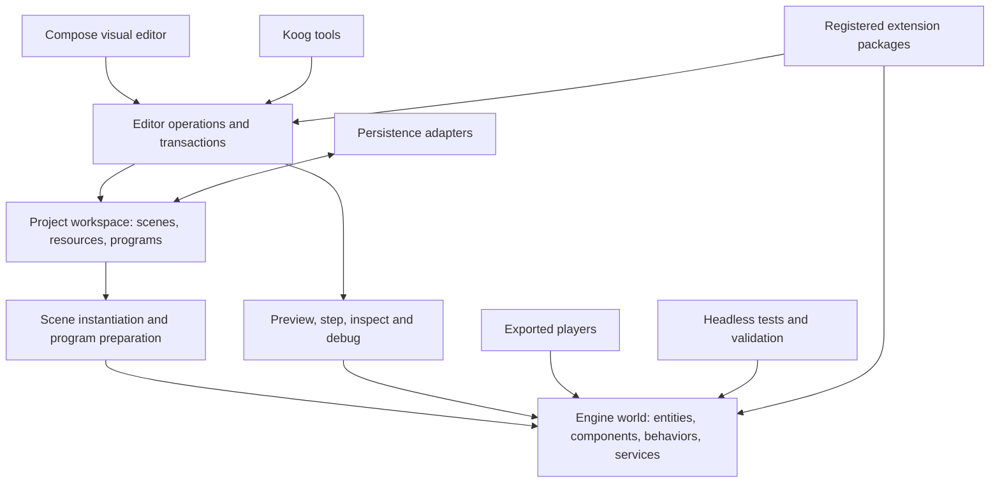

# SpawnKit — general-purpose engine architecture revision

Status: **accepted direction and creation requirements**, 2026-11-20. The owner confirmed engine ownership, removed time pressure as an architectural constraint, selected guided visual creation and requested implementation of the documentation revision. Dependency and backend choices still require R1 evidence. This document describes the target, not shipped functionality.

This revision supersedes the document-first premise and affected future work in the [original design](2026-11-19-spawnkit-design.md). It preserves its product scope and mandatory technologies. The [revised implementation plan](../plans/2026-11-20-engine-foundation-revision.md) replaces the unfinished sequence. Existing code remains working migration input.

Review checkpoint, 2026-11-20: the owner renewed the request to reevaluate alternatives and revise the plan before implementation. The [alternatives reassessment](2026-11-20-engine-alternatives-review.md) records the current recommendation, candidate evidence and unresolved choices. The accepted requirements remain; this addendum and the updated plan are proposed for review. Do not continue implementation until the owner reviews the revision and directs continuation.

## 1. Product and architectural objective

SpawnKit is a general-purpose, extensible 2D game engine built with Kotlin Multiplatform, with an integrated Compose Multiplatform visual editor. Creators build games without code; developers can implement reusable components, behaviors and tools. Koog agents use real editor and engine capabilities to create, inspect, run, debug and validate games. Ktor powers publishing and hosted services. Monetization, export, arcade distribution and a marketplace remain part of the product.

Engine ownership and accessible creation are equally important requirements. SpawnKit owns its runtime, gameplay APIs, behavior execution, editor capabilities and extension SDK. Focused supporting libraries are allowed; adopting another complete engine as SpawnKit's foundation is outside the accepted direction. A creator does not need programming knowledge, source code, serialized-file editing or technical identifiers to build a game. Developer code and advanced authoring remain optional ways to extend the same engine.

The engine's capabilities are executable APIs and registered implementations. Scenes, entities, components, resources and programs exist as meaningful objects independently of their storage format. A project can be constructed, run and edited without first producing JSON or passing through a template document compiler.

General-purpose means creators can combine reusable primitives and author new computation and state transitions; developers can add capabilities through public extension APIs without editing engine source. It does not promise every physics algorithm, platform service or genre feature at the first release. Those features must be implementable as packages rather than additions to a central list of approved mechanics.

Platformer Adventure is the first demonstration package. Coins, patrol, coyote jumping, checkpoints, goals and sequential level progression are demo behavior. They must not be requirements of a world, scene, scheduler, renderer, input system or editor.

## 2. What the implementation audit found

The existing implementation is a tested platformer slice, with valuable infrastructure. Its constraints go beyond JSON:

| Current location | Constraint | Treatment |
|---|---|---|
| `core/model/.../Component.kt` | Closed serialized component hierarchy includes platformer mechanics | Preserve v1 decoding; introduce an independent open type-registration contract |
| `core/engine/.../WorldCompiler.kt` | Requires exactly one `PlayerController` and constructs player state | Retain as legacy/demo entry point during migration; generic scene instantiation has no player requirement |
| `EntityStore.kt`, `RuntimeWorld.kt` | Fixed entity count, role-specific arrays, mandatory player and respawn state | Extract useful storage/collision techniques; add general lifecycle and extension-owned state |
| `GameSession.kt` | Directly invokes platformer/patrol/interaction systems; completion freezes the world | Move mechanics into a package; use an explicit general scheduler |
| `Input.kt`, `GameEvent.kt` | Closed gameplay actions and events | Keep platformer mappings; add registered actions, axes, pointer input and typed messages |
| `render/.../WorldPainter.kt` | Camera follows player; tags select coin/enemy/flag appearance | Preserve drawing/interpolation math; use explicit cameras and drawable resources |
| Paused `player/shared/.../PlayerState.kt` | Title, sequential levels, adventure completion | Preserve as demo presentation, not universal game lifecycle |

Preserve build conventions, target configuration, CI, IDs, migration discipline, fixed-step clock, viewport/camera math, input cancellation, bundled font, renderer regression tooling and deterministic tests. The old platformer golden remains a regression for its compatibility path, not proof of general engine behavior.

## 3. Alternatives evaluated

The following recommendation is an engineering inference from the project's requirements and the cited primary sources, not a claim that one pattern is universally superior.

| Approach | Strength | Cost or limitation here | Decision |
|---|---|---|---|
| Extensible scene tree / object components | Direct visual hierarchy, reusable scenes, approachable inspector and callbacks | Deep inheritance and implicit callback ordering can create coupling | Use scene composition and component APIs; avoid an inheritance tree of game genres |
| Pure ECS as the public model | Open component types, queries and scheduled processing; efficient bulk updates | Does not supply visual authoring, programmable behavior, metadata, packages or persistence by itself | Keep ECS techniques available inside runtime storage; do not make creators author storage internals |
| Scene/component authoring with scheduled runtime | Natural editor model plus explicit execution, replaceable storage and open types | Requires clear instance identity, lifecycle and authoring/runtime mapping | **Recommended**, with one capability/type contract and separate authoring and play instances |
| Immutable state with event reducers throughout | Explicit transitions, useful for authoring history and testing | Whole-world copying/replay and extension-owned mutable state require additional design and measurement | Apply transactions/history to authoring where useful; do not mandate immutable/event-sourced simulation |
| Adopt a complete engine such as KorGE | Existing rendering, input and platform facilities | Would place ownership of the engine foundation outside SpawnKit; integration/target suitability is also unproven | Researched alternative, excluded by the owner's engine-ownership requirement; individual supporting facilities may still be evaluated |
| Keep the current closed document/compiler and add more mechanics | Smallest immediate change | New core cases still gate expressiveness | Rejected: does not satisfy the revised objective |

Godot documents loosely coupled scene composition and distinguishes nodes' functionality from reusable resource data. Unity Entities separates identity, data and processing. These are useful precedents, rather than specifications to copy. [Godot scene organization](https://docs.godotengine.org/en/stable/tutorials/best_practices/scene_organization.html), [Godot resources](https://docs.godotengine.org/en/stable/tutorials/scripting/resources.html), [Unity ECS concepts](https://docs.unity3d.com/Packages/com.unity.entities@1.3/manual/concepts-intro.html).

### Library selection

Retain the existing Compose presentation path and introduce SpawnKit's component-runtime API, comparing Fleks versus a simple custom store behind it before choosing the storage implementation. Fleks is an MIT Kotlin multiplatform ECS candidate. KorGE remains a researched engine alternative; any selected facility from it must remain a focused implementation dependency rather than replacing SpawnKit's engine/program/editor contracts. Neither repository proves SpawnKit's entire platform or determinism contract. [Fleks](https://github.com/Quillraven/Fleks), [KorGE](https://github.com/korlibs/korge).

The comparison must measure target compilation, dynamic lifecycle, ordering, snapshots, headless replay, external type registration, dependencies/license, current toolchain compatibility and representative entity counts. A heavyweight ECS rewrite is not justified by a label or an assumed performance benefit. Select focused libraries for demonstrated technical suitability while retaining engine ownership; delivery speed or a contest deadline cannot justify changing these boundaries. No dependency is adopted by this document.

## 4. Recommended architecture

Names in this document express responsibilities, not frozen class signatures or a mandate to create all modules immediately.

### 4.1 Engine kernel

- An engine host registers packages, services, types, operations and scheduled systems before worlds are instantiated.
- A world owns generation-checked entity handles, component instances, resources, lifecycle and execution state. Stable authoring/resource IDs are mapped to runtime instance handles; duplicated scene instances do not share mutable component state accidentally.
- Create/destroy entities, attach/remove components, query components, instantiate reusable scenes and send typed messages through public APIs. Structural mutation is queued to specified phase boundaries to avoid invalidating an active iteration.
- Optional parent relationships support hierarchy and transform composition. No deep object inheritance is required. Resources include textures, clips, fonts, materials, prefab/scene definitions and behavior programs.
- Scheduler phases, dependency ordering and tie-breaking are explicit. Initial simulation is single-threaded; parallel execution is a later optimization that must preserve declared semantics.
- Worlds can be empty, headless, UI-only, paused or run simultaneously. There is no mandatory player, tile map, gravity, score variable, goal or finite list of scenes to finish.
- Runtime extension code calls typed Kotlin APIs directly. Descriptor-based invocation serves tools and portable programs; ordinary simulation does not need string dispatch or editor transactions on every component update.

### 4.2 Reusable 2D facilities

First foundation: transforms and hierarchy; explicit cameras; sprites and primitive drawables; layers; animation/tween playback; named input actions/axes and pointer events; collision shapes, filtering, overlap/raycast queries and contact events; configurable kinematic motion; timers; seeded randomness; typed state/events; scene/prefab instantiation; asset handles and game-UI bindings.

Facilities are optional modules/packages. Physics does not decide that an overlapping object is a coin, enemy or goal. A camera follows an explicitly selected target or authored behavior. Input bindings are resources, not a global six-action enum. Scene switching and restart are exposed operations, not mandatory game rules. Score, inventory, dialogue, character evolution and purchases are assembled through logic and optional packages.

World units are abstract engine units; a tile grid selects its cell size. Preserve the existing demo's y-down, one-unit tile convention through its adapter. Transform APIs must accommodate rotation/scale. First collision support can remain axis-aligned; advanced rigid-body/rotated collision support is a replaceable physics facility with a declared capability profile, not a claim already fulfilled.

### 4.3 Open registration and metadata

Runtime components and behaviors are not a sealed union in `core/model`. An extension registers a stable namespaced type ID, factory, lifecycle hooks and descriptors for properties, functions and events. Descriptors declare value types, constraints, documentation, version, availability, effects and deterministic compatibility. Serialization codecs, property inspectors, graph nodes and validators attach to this type contract rather than defining it.

Authoring descriptors also provide friendly display names, explanations, categories, sensible defaults, units, constraints, object/resource reference pickers, examples, contextual help and visibility levels. These drive usable property controls and behavior forms automatically, including for extension-defined capabilities. Custom inspectors may improve that baseline but are not required for every package. Raw type IDs, expression syntax and serializer fields are not the beginner interface. Editor wording can present entities/components as Objects, Properties, Behaviors and Game rules without changing engine semantics.

Use explicit common Kotlin descriptors initially; generate repetitive bindings later only when justified. Do not depend on JVM reflection or serializer metadata to discover all executable capabilities. Bevy's type registry is a useful precedent for associating metadata and optional operations; it is not a proposed Rust dependency. [Bevy reflection/type registration](https://docs.rs/bevy_reflect/latest/bevy_reflect/), [Kotlin reflection](https://kotlinlang.org/docs/reflection.html).

Keep engine operations, editor operations and platform services distinct. A property getter or collider query can be exposed to all three relevant consumers; installing packages or publishing a game is a host operation with separate effects. Shared registration does not mean an in-game script can invoke every editor or network tool.

## 5. Custom gameplay logic

Extensibility needs both a programming surface for creators and an SDK for developers.

### 5.1 Portable creator programs

Recommend typed visual programs executed by a common Kotlin interpreter, with prepared instructions and resolved capability bindings. Begin with a small typed intermediate representation and interpreter; introduce bytecode optimization only if profiling justifies it. This is executable user logic, not a collection of genre configuration cases.

The semantic foundation includes values and user-defined records, local/persistent state, collections, parameters and returns, user functions/reusable subgraphs, branching, iteration, custom events, timers, entity queries and calls into registered runtime functions. Event sheets are the approachable first authoring view; a freeform node graph can expose the same program later. Both must share execution semantics. A textual scripting frontend can target the same representation later, without introducing another gameplay engine.

Examples include custom combat damage rules, puzzle adjacency logic, tower target selection, production chains or inventory recipes. Implement these through ordinary state/functions/queries; do not add opcodes named after each game mechanic. Unity's executable custom visual-script nodes illustrate the distinction between programmable behavior and a fixed form. [Unity custom nodes](https://docs.unity3d.com/Packages/com.unity.visualscripting@1.9/manual/vs-create-custom-node.html).

Instruction, allocation, recursion, event and entity budgets need defined failure semantics and source-level diagnostics. Recommend atomic execution segments: buffer program-state and world writes, messages and host-effect requests until a handler returns or reaches an explicit yield; reads observe the segment's own writes. A fault or budget exhaustion discards that segment's buffered effects and faults the behavior. Previously committed segments remain. Explicit yields commit a resumable continuation. Resource accounting includes deterministic charges for host calls, not just interpreter instructions. Portable host bindings must obey the same effect contract; it must be proved in R1 and documented before exposing it to creators.

Infinite loops cannot block the host. Wall-clock watchdogs are host safeguards that abort a run with an inconclusive/aborted result; their timing must not become a deterministic gameplay outcome. Limits constrain resource use, not the choice of genre. Suspended continuations and timers are explicit state. Native callbacks cannot be preempted safely merely by passing a budget parameter; only trusted/bounded calls belong in this portable execution lane.

This is a significant implementation cost. Do not design a large general language or multiple frontends before a working function/event/loop slice is tested. Compare an existing embeddable language/interpreter against this common representation in the foundation spike; adoption requires actual JVM/JS/Wasm/Native support, typed host binding, bounded execution, license and replay evidence. Lua/JavaScript/Wasm are alternatives, not assumed dependencies.

### 5.2 Compiled developer extensions

KMP packages may add typed components, systems, Kotlin behaviors, runtime operations, services and optional Compose editor integrations through a public SDK. They can implement gameplay not anticipated by the original engine, without modifying engine source. Built-in modules use the same registration path as third-party modules.

The initial portable route is to resolve and compile trusted packages into the creator/player build for each supported target. A static code dependency is a real extension; Bevy uses this model for third-party plugins. Desktop hot-loading can be added separately if valuable. [Bevy plugins](https://bevy.org/learn/quick-start/getting-started/plugins/).

Do not promise one dynamically loadable Kotlin binary across JVM, browser and iOS. Kotlin's official custom scripting host is experimental and JVM-based; it is not evidence of universal `.kts` gameplay execution. Kotlin/Native is a distinct native compilation path. [Kotlin scripting](https://kotlinlang.org/docs/custom-script-deps-tutorial.html), [Kotlin/Native](https://kotlinlang.org/docs/native-overview.html).

## 6. Integrated editor and agent tools

The authoring workspace owns editable scenes, entities, resources, programs and package dependencies. It is independent of the persistence codec. Play instantiates a separate world through the same runtime APIs used by exported players and tests. Stop discards play state; applying selected debug changes back to authoring is a separate explicit operation, not silent mutation of the project.

Editor operations create/delete/reparent entities, attach components/behaviors, set typed properties, connect events, author functions/programs, import assets, instantiate scenes and invoke extension-provided tools. Transactions include preconditions, revision checking, diagnostics, undo/redo and rollback on failure. Selection, layout, gizmos and camera navigation remain editor state. Plugins can add inspectors, gizmos, importers, panels and validators through the editor SDK. Godot demonstrates custom editor nodes/docks and shared undo histories. [Godot editor plugins](https://docs.godotengine.org/en/stable/tutorials/plugins/editor/making_plugins.html), [Godot undo manager](https://docs.godotengine.org/en/stable/classes/class_editorundoredomanager.html).

Koog tools adapt these real typed operations. Agents discover installed capabilities, inspect objects, construct behavior, run a staged workspace in the real engine, inspect results/traces and propose a transaction. Human acceptance commits against the expected workspace revision; rejection discards the staged changes. UI and AI must have equivalent effects and validation. A compact level/character specification may remain a convenient tool argument, but it is only one frontend to this capability surface. JSON transport of tool arguments does not define game semantics. [Koog class-based tools](https://docs.koog.ai/tools/class-based-tools/).

Preserve Level Designer, Character Forge and Game Architect, procedural creation, repair loops, media generation, cost/budget controls, cancel, history and labelled replay. Extend agents to create new behavior/functions and use installed extensions, rather than limiting them to predefined template mechanics. Generated Kotlin/native code, if offered later, follows a separate reviewed build workflow; it is not silently executed as a normal agent tool.

### 6.1 Guided visual creation

Guided visual creation is the default. AI is an optional helper throughout; a functional blank project and visual authoring tools do not require templates, model credentials or AI-generated starting content.

| Step | Creator action | Required behavior |
|---|---|---|
| Start | Create a blank project or choose an optional example | Blank projects have a usable scene and clear next actions; onboarding can be skipped or resumed |
| Build | Drag objects into the scene; arrange and customize them | Direct manipulation, visible selection, drag-and-drop placement and immediate feedback |
| Add behavior | Choose a capability and adjust its settings | Friendly behavior forms with useful defaults, examples and a live preview where applicable |
| Create rules | Assemble When / If / Do statements | Object pickers, dropdowns and visual value controls; no required code, expression strings or technical IDs |
| Test | Press Play, inspect the result and return to editing | Safe Play/Stop, visible behavior feedback and a clear route to the responsible object/rule |
| Share | Select an export or publishing destination | Guided validation, progress, actionable failures and explanations of actual platform/account requirements |

For example, a creator assembles: **When the character touches this object, increase Score by 1 and remove the object.** The UI offers each part as a selectable field and can create the Score counter through a visual action. No one needs to type that sentence as code or understand how it is stored.

Ready-made movement, interaction and animation behaviors are editable assemblies built with public engine capabilities. They are conveniences, not the finite vocabulary of allowed mechanics. Guided steps scaffold the same functions and behavior programs used by event sheets, advanced graphs, agents and developer extensions. Users can compose unfamiliar logic through these tools; there is no separate beginner execution model or project format.

### 6.2 Learnability, recovery and accessibility

Provide contextual instructions, inline examples, sensible defaults, optional onboarding, immediate previews, undo/redo, autosave and recoverable failures. Errors identify the object or behavior, explain the problem in plain language and offer a corrective action; stack traces and internal IDs belong in optional diagnostics. Missing dependencies and failed AI edits must preserve the creator's work. AI proposals explain understandable changes and offer runnable previews before acceptance.

Progressive disclosure reveals advanced graphs, reusable functions, types and technical settings without making them prerequisites for ordinary creation. Basic and advanced views edit the same project and retain each other's work. Keyboard navigation, visible focus, readable contrast and scalable text are acceptance requirements. Creator scope remains desktop/web first, with tablet/mobile editing following the retained roadmap; player touch support remains mandatory on mobile.

Platform publishing may require external accounts, signing or platform consent; the guided flow must explain these requirements and preserve progress. Ordinary local game creation and play must work without AI credentials, payment setup or mandatory cloud services.

## 7. Determinism, testing and validation

Keep a deterministic simulation profile: fixed 60 Hz, explicit order for systems/queries/events/structural changes, controlled numeric operations, seeded RNG and no implicit wall-clock/I/O in deterministic behaviors. Deterministic packages must capture, restore and hash all mutable component, behavior, system and service state, including private Kotlin fields, timers and continuations. Mid-run snapshot → restore → replay equivalence is an SDK conformance test. Stable namespaced IDs and ordering cannot depend on map iteration or plugin installation order.

Preserve current platformer hashes for unchanged legacy execution. New semantics need new documented tests, not an unexplained replacement golden. Future rotation/math facilities need portable tested math if they participate in this profile; presentation can use normal platform rendering math. Arbitrary linked third-party code is not automatically deterministic: packages declare compatibility and run conformance tests. Nondeterministic services are labelled and excluded from claims of replay equivalence; this must not weaken the existing profile's checks.

Generic validation checks references, capability/type/dependency compatibility, budgets, component invariants and runtime faults. Packages add domain-specific checks. Platformer reachability and tycoon economy checks remain valuable validators, not universal definitions of playability. General user programs cannot all be proven correct or terminating by a fixed reachability solver. Validation reports must state scenario coverage, seeds, budgets and inconclusive results honestly.

The same installed runtime packages, prepared programs and version locks run in editor preview, headless validation and exports. Native packages are trusted code; server validation cannot safely execute arbitrary uploads in its own process. Initially accept only approved runtime package sets there; later build/execution workers require real isolation.

## 8. Persistence, packaging and marketplace

Recommended initial authoring storage is a project directory with a small manifest, separate scene/prefab/program resources, content-addressed assets and a dependency lock. Retain JSON as the initial readable codec where useful, behind save/load/import interfaces. TOML/YAML would change readability, not engine expressiveness; SQLite or binary formats need measured transactional/runtime benefits before adoption. Export may use a prepared, compact format independent of authoring storage. Browser storage implements the same repository interface, initially through explicit import/export and a size-limited local store; OPFS/cloud sync remain roadmap work.

Preserve the v1 `GameProject` decoder and template fixtures as a legacy import path. New persistence is separately versioned; old JSON is migrated deliberately rather than reinterpreted silently. Do not edit the old schema destructively or introduce a second implicit runtime based on file formats.

Marketplace packages have separate categories:

| Package | Installation / execution | Examples |
|---|---|---|
| Content | Import resources; no native code | Art, sounds, reusable scenes, prefabs |
| Portable logic | Load verified programs against available capabilities | Behaviors, functions, state machines, event-sheet libraries |
| Compiled runtime extension | Resolve target artifacts/source and rebuild approved players | New components, physics, render/service integrations |
| Editor extension | Install into compatible creator builds; omit from players | Inspectors, gizmos, importers, panels, validators |

A package declares identity/version, engine/SDK requirements, runtime targets, editor requirements, dependencies, migrations, requested capabilities, license and provenance. Lock exact versions/hashes for reproducible validation and builds. Separate storage schema, SDK API and program-format compatibility. Missing packages remain identifiable and losslessly preserved while editing, but block execution/export with an actionable error.

Signatures/hashes identify origin and integrity; they do not sandbox native code. Portable programs get only explicitly permitted runtime services. Publishing/payments/ads are asynchronous host services with explicit result events, outside the deterministic tick. Correlate requests and deduplicate completion events so a retry/replay cannot duplicate a host effect. Record results and reinject them as ordered external inputs during replay; replay must never make a new purchase or ad request. Never grant filesystem, arbitrary network or native-code execution merely because a package has metadata.

Store distribution is a product-specific deployment constraint: a universal player can execute only its installed runtime capabilities. Compiled extensions require compatible builds; portable behavior can reuse an installed interpreter. Apple's rules address downloaded code and particular hosted-content exceptions; encoding a program as data does not establish compliance. Keep mobile compiled packages bundled initially and review dynamic hosting separately before launch. [Apple App Review Guidelines, especially 2.5.2 and 4.7](https://developer.apple.com/app-store/review/guidelines/).

## 9. Module responsibility map

This is a staged responsibility map, not permission to generate empty modules. Existing paths may be retained or split when a concrete migration step needs it.

| Responsibility | Candidate boundary | Dependency direction |
|---|---|---|
| Handles, type/capability registration, world and scheduler | Existing independent `core/runtime`; consolidate paths only through reviewed migration | No Compose, persistence codec, Koog or platformer dependency |
| General components and 2D facilities | `engine/*` or small first-party packages | Engine SDK; optional physics/render adapters |
| Portable programs/compiler/interpreter | `core/behavior` | Engine capability/value contracts; no editor UI |
| Editable scenes/resources and persistence adapters | `core/project` + legacy `core/model` adapter | Engine/type contracts; codecs at the boundary |
| Transactions, undo, editor capabilities | `core/editing` | Project/workspace and engine interfaces |
| Headless scenarios, assertions and package validators | `core/validation` | Same engine/program implementations as player |
| Compose rendering and editor UI | `render`, `app/shared`, optional `app/designsystem` | Runtime observations/editor APIs |
| Demo behaviors and resources | `samples/platformer`, `samples/tycoon`, sample assets | Public engine/editor SDK only |
| Extension registration and packaging | SDK contracts + tooling as needed | Generic kernel; no central per-extension switches |
| Agents and media | `ai` | Editor/engine tools and validators; Koog |
| Player shells | `player/*` | Engine host, installed packages, supplied entry scene/UI |
| Publishing, registry and build services | `server`, `core/api` | Ktor; isolated/approved validation and build workers |

## 10. Proof of the architecture

The foundation is not complete until these are demonstrated:

1. Construct, edit, tick and inspect an empty world directly through APIs without JSON, a player, gravity or a level-complete concept.
2. Build Platformer Adventure, a top-down puzzle/action game and Brainrot Tycoon using the same frozen engine surface. No kernel edits, genre checks or new sealed gameplay cases between demonstrations. A visual/UI-only scene must also be legal.
3. Author at least one new mechanic using state, functions, iteration, events and queries in the portable programming surface, without adding a mechanic-specific engine instruction.
4. In a separate consumer/test package, register a new component, behavior and operation. It appears in the inspector and no-code palette, can be called by Koog, runs headlessly and exports on its declared targets, without core source changes.
5. UI and agent operations produce equivalent results; undo restores authoring state; Play/Stop isolates runtime changes. Save/load is tested separately from those capabilities.
6. The registered deterministic profile produces equivalent results across JVM, JS, Wasm and supported Native targets. Legacy regressions continue to pass during migration.

### Usability release gate

The engine/editor release also requires evidence from first-time non-programmers. At least four of five participants must independently create and modify a small playable game, correct a seeded rule/object mistake, undo a change, save/reopen and launch it. Built-in guidance is allowed; instructor intervention and AI assistance are excluded from this baseline. Record observed results and failures without presenting an internal walkthrough as a completed user study.

Repeat creation exercises across two mechanically different games and an extension-provided behavior. Verify the export flow separately on supported targets. None of these creation exercises may require coding, JSON editing, technical IDs or API keys. Observe completion and recovery, rather than imposing a time-to-completion deadline. This usability gate supplements all engine/extension proofs; passing one does not replace the other.

## 11. Product commitments and delivery

All original product features remain: no-code visual editing, templates and character evolution, Koog agent roles and real-engine verification, transparent art generation, honest replay, procedural generation, desktop/web/Android/iOS players, Pages arcade, Ktor publishing, per-game identity/builds, accounts/sync, analytics, cloud builds, monetization/ads/consent/IAP, creator-owned accounts, marketplace licensing/provenance/moderation/payments and managed publishing subject to platform review. Story/quest/inventory tools, animation tooling, agentic characters and later 3D remain on the longer-term roadmap.

The owner explicitly removed time pressure as an architectural constraint. Progress follows capability, correctness and usability gates, with estimates describing measured work. The former contest-driven daily schedule and cut-lines no longer determine engine scope or design. The contest remains a showcase opportunity for the version ready at submission; it does not justify weakening engine generality, extension ownership or beginner usability. The full commercial roadmap remains.

Runtime/editor migration follows the [replacement sequence](../plans/2026-11-20-engine-foundation-revision.md). R0 reconciliation is complete; merged [R1a](../runtime-foundation.md) supplies initial headless lifecycle/scheduling evidence and a separate public-API consumer, and merged [R1b](../runtime-checkpoints.md) supplies declared native state capture/restore/replay. Remaining R1 storage/program/effect comparisons and the visual editor are unfinished. Review the reassessed plan before further implementation; do not restart old Tasks 11–12 or claim planned interfaces are already implemented.
