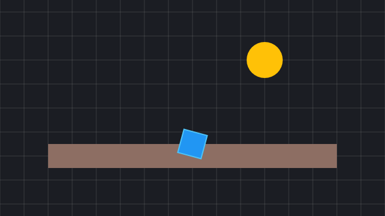

# 2D presentation facilities — C1 (R3 subset)

Tracked by [issue #44](https://github.com/aioanei/spawnkit/issues/44). This is item C1 of the
[contest delivery track](plans/2026-11-20-engine-foundation-revision.md#contest-delivery-track).

## Components (`core/graphics`)

`Graphics2D(builder)` installs presentation components through the public SDK, the same way any extension does.
Each comes with a descriptor, so the generated inspector, rules and agents can edit it without custom code.

| Component | Properties | Notes |
|---|---|---|
| `Transform2D` | x, y, rotation (degrees, clockwise), scaleX/scaleY (advanced) | Local to the parent; composed through the R2b hierarchy. y points down. |
| `Shape2D` | form (rectangle or ellipse), width, height, color, layer, visible | Centred on the object's origin. |
| `Sprite2D` | asset, width, height, tint (advanced), layer, visible | References a project asset ID. A missing image draws a visible placeholder. |
| `Camera2D` | zoom, active | The first active camera in scene order is used. |

`ValueKind.Color` (ARGB in a `Long`) was added to descriptors for color pickers. Colors are not bound to programs
yet.

## Render list

`graphics.renderList(world)` reads a world and returns:

- **Draw order:** items sorted by ascending layer, then scene order (parents before children, siblings in order,
  roots by slot). A stable sort keeps scene order within a layer.
- **Placement:** each item's local-to-world `Affine2D`, plus the resolved world transform of every object.
- **Camera:** the active `CameraView`.
- **`hitTest(x, y)`:** the topmost visible item at a world point, honouring rotation, scale and ellipses. The editor
  uses it for selection.

`ViewTransform` maps world coordinates to a pixel viewport (`worldToScreen`, `toWorld`) from a camera, the viewport
size and pixels per unit.

Presentation uses trigonometry and floating-point transforms. It only reads the world and never changes simulation
state, so the deterministic simulation contract is unaffected.

## Renderer (`render`)

`RuntimeCanvas(frame, …)` and `DrawScope.drawRenderList(…)` draw a render list with Compose: shapes, sprites from
supplied `ImageBitmap`s (with tint), an optional grid and selection outlines. The editor viewport and exported
players share this renderer, so what creators see while editing is what players see. It compiles for Android,
desktop, iOS, JS and Wasm.

The image above is produced by `RuntimeCanvasRenderTest` (JVM), which renders a runtime scene offscreen with Skia and
asserts actual pixel colors: the ground, the hero drawn over the ground where both overlap (layer order), and the
camera-relative sun position. Invalid camera zoom values set natively are ignored or clamped, and the grid spacing
adapts in powers of ten with a bounded line count.

## Evidence

- `Graphics2DTest` (common, all core targets) covers:
  - transform composition through the hierarchy, and inverses;
  - layer and scene draw order, including hidden items;
  - hit tests on rotated, scaled and elliptical items and across layers;
  - camera and viewport conversion;
  - descriptor edits, including invalid color and choice;
  - checkpoint round trip.
- `RuntimeCanvasRenderTest` (JVM) checks pixels as described above.

## Not yet

- Sprite sheets and animation.
- Tilemaps.
- Text and game UI.
- Collision and physics facilities (the rest of R3).
- Asset storage (C5).
- Camera follow behaviors.
