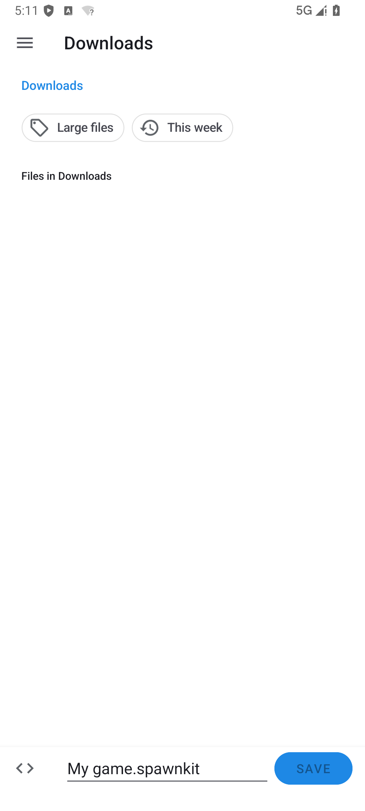
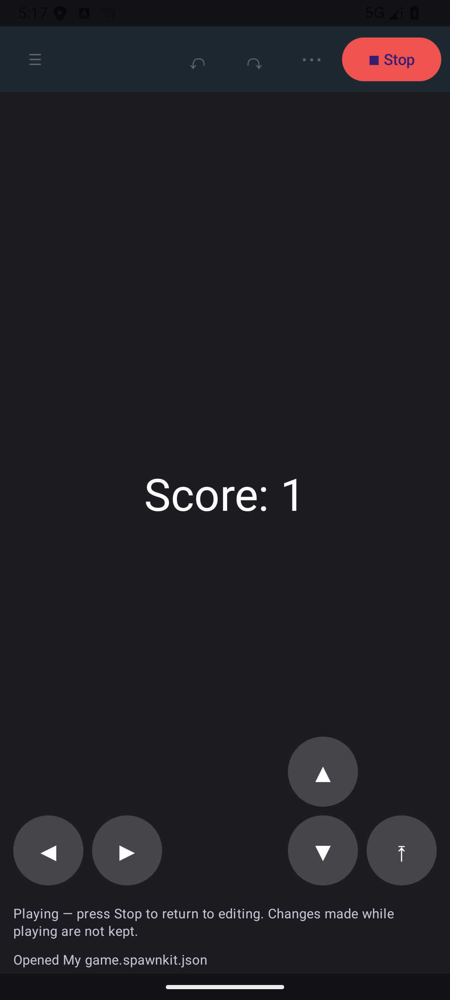
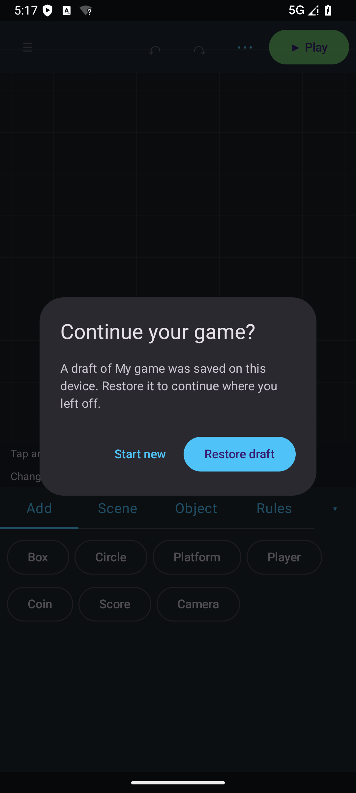

# Project files and recovery — C5

[Issue #56](https://github.com/aioanei/spawnkit/issues/56) delivers the persistence slice of R5. The workspace and
runtime remain executable APIs independent of storage. `core/editing` owns the project-file boundary; the legacy
platformer codec in `core/model` remains a separate format.

## In the builder

Open **Project** in the toolbar on either a phone or desktop:

- **New game…** opens a picker: **Blank**, or one of the preset games (see below).
- **Open project file…** imports a `.spawnkit` file through the system picker.
- **Save** writes to the selected file, or asks for a location the first time.
- **Save a copy…** chooses another location and writes a portable project file.
- **Rename game…** changes the game name as one undoable editor operation.

On narrow phones, **☰** opens Project and **⋯** opens the selected object's Duplicate/Delete actions. Both controls
have accessible descriptions. Some Android document providers append `.json` to `.spawnkit`; either name opens.

### Preset games (C10)

The picker lists Blank and three preset games, each with a picture of its game scene and a one-line pitch. Phones
show one column; wider screens show two.

| Preset | Game | Uses |
|---|---|---|
| Coin Dash | Move with the arrows and collect every coin; the last coin leads to "You win". | Key held, Touching, Count is |
| Tap Targets | Tap the moving targets before the 20-second timer runs out. | Tapped, Every second, Number is |
| Maze Run | Reach the exit; touching a wall restarts the maze. | Key held, Touching, Go to scene |

- **Ordinary projects.** Each preset is a normal project file in `presets/<id>/project.json` with a title screen. It
  is embedded into the app by `core/presets` (`EmbeddedPresets`, listed by `GamePresets`).
- **How they were made.** With the builder's own calls: palette presets, catalog operations, rule operations and
  "Add title screen". The recipes are in `app/shared/test@jvm/.../presets/PresetRecipes.kt`, and a test checks the
  files against them ([presets/README.md](../presets/README.md)).
- **Only today's blocks.** Edge walls and bouncing targets are built from Touching, Move and Set number. Spawning,
  random placement and game-wide numbers need new blocks, so games that depend on them are not presets yet.
- **A copy with no file.** Choosing a preset asks about unsaved changes like New and Open. It then loads a fresh copy
  that opens on its title screen, with a new undo history. Save asks where to keep it, so a file opened earlier is
  never overwritten, and autosave covers it from the start. A preset that cannot be read keeps the current game and
  says so.
- **Outside the editing catalog.** Starting from a preset is a project-file action like New and Open, so it has no
  agent tool and no parity case (ADR-0009). An agent builds the same content through the catalog's operations.

New and Open ask before replacing unsaved changes. Save and continue, Discard changes, and Cancel are explicit.
Cancelling a picker, opening a bad file, and a failed write keep the current project and its undo history. Opening a
valid file starts a new undo history. Play uses an isolated world and never writes play state into the project.

Changes, including undo/redo, autosave after 500 ms of idle time. Lifecycle stop and disposal also flush the current
workspace. At startup, **Restore draft** resumes local work; **Start new** is explicit. If the newest draft is damaged,
the previous valid draft is offered and the damaged contents are retained separately. Autosave failures say to save a
project file. Abrupt termination inside the debounce interval may lose edits that have not yet flushed.

Android uses the Storage Access Framework; desktop uses a Swing file chooser. Locations and permission handles stay
in the host session, outside project files. Restoring a draft asks for a file location on the next Save. No cloud
account, model key or credentials are involved.

## File format

`ProjectCodec` reads and writes schema version **1**, identified by `format: "spawnkit-project"`. JSON is the initial
storage codec, not the engine contract. A portable file contains the game name and ID counter, scenes/objects in
authoring order, stable IDs and parents, component IDs and authored values, and rule handlers with source labels and
node IDs. Every current handler expression/statement kind is represented.

Whole numbers and decimals have separate tags, preserving signed 64-bit integers and doubles, including negative
zero. Booleans, strings and opaque JSON property data also round-trip. Missing components need not be installed to
save their values. Host function/property/event/effect names remain open strings. Incomplete advanced rules are kept
and checked by Play; the codec does not replace program type checking.

Runtime entity handles cannot be portable literals: saving them fails with a suggestion to use this object, tags or
queries. Entity-valued expressions and typed lists remain supported. Workspace rules are handlers; per-object
function/state authoring remains planned rather than being invented by the format.

Files are limited to 4,194,304 UTF-16 characters and 128 nested JSON containers. Platform readers enforce the character
limit while reading. Object ancestry is bounded to 128 levels before recursive editor presentation. Unsupported
versions, fields, instructions and invalid structures fail before replacing the
editor. Newer data is never silently ignored. Future breaking schema changes require an explicit migration; the
initial version has no predecessor. Legacy `GameProject` files are not silently reinterpreted.

`Editor.saveSnapshot()` keeps the counter above IDs retired by undo. Reopening a snapshot cannot reuse them. Undo
history and transient selection/camera/play state are not part of the portable file.

## Missing capabilities

An opened project keeps unavailable components and unsupported property values. Its preview omits unavailable
components and uses defaults for unsupported values; this projection never changes the project. The inspector names
unavailable components. Play is blocked with an object-specific explanation until the matching capability is installed
or the affected setting is corrected. `Project.capabilityProblems(runtime)` supplies the same check to headless callers.

## Game packages for release (C6)

A game package is what a SpawnKit player runs without the creator app, for web export, the Arcade and the Kotlin
Toolchain release service (issue #64, [Release Manager build architecture](design/2026-11-20-release-manager-kotlin-toolchain.md)).
`GamePackage.of(project, title, startScene)` validates the release fields, and `GamePackageCodec` encodes them:

```json
{"format":"spawnkit-game","packageVersion":1,"runtimeVersion":1,"title":"Coin Run","startScene":"scene-1",
 "requiredComponents":["gameplay:tag","graphics:shape","graphics:transform"],
 "project":{"format":"spawnkit-project","schemaVersion":1, "...": "..."}}
```

- The project is the unchanged project-file document, so decoding reuses all project validation.
- `runtimeVersion` identifies the player compatibility level. The first v1 packages omitted this field and use level 1.
  The player explains when a release requires a different runtime.
- `requiredComponents` is derived from the project. A package whose list disagrees with its contents is reported as
  damaged instead of being trusted.
- Players call `missingComponents(runtime)` before running, and explain which capabilities they lack.
- Foreign files, newer package versions, unknown start scenes, malformed JSON and oversized input fail with
  player-facing messages. Parser details are not shown.
- The Release Manager and Arcade call `releaseProblem(runtime, host)` to validate component settings and compile
  the rules for every scene against the destination player's installed capabilities before publishing.

## Recovery boundary

`DraftStore` supplies atomic per-key storage. `ProjectJournal` uses three keys:

| Key | Contents |
|---|---|
| `draft` | Newest complete project snapshot |
| `previous` | Previous valid draft, written before replacing `draft` |
| `damaged` | Last unreadable draft, archived before replacement |

Encoding finishes before storage changes. A backup failure prevents replacement of the current draft; a failed atomic
replacement retains its old contents. Recovery inspection is read-only. Starting a new/restored session archives
unreadable current data before replacing it.

| Platform | Local recovery | Project files |
|---|---|---|
| Desktop | `~/.spawnkit/recovery/`, synced temporary file and atomic rename | Swing chooser, atomic replacement |
| Android | App-private `files/recovery/`, Android `AtomicFile` | Document picker/provider; an internal draft precedes external writes |
| Browser JS/Wasm | Origin-local `localStorage`, subject to browser quota | File import/export remains planned |
| iOS | App-local preferences adapter | Document picker remains planned; compilation checked in CI |

Desktop filesystems must support atomic rename; failures are reported. Android providers control external writes, so
a failed provider may leave a partial external file; the internal autosave remains available. Local recovery is not
an off-device backup. Quota and storage errors preserve the open workspace. iOS sudden-termination durability has not
been device-validated.

## Evidence

`ProjectPersistenceTest` covers all portable handler node shapes, typed values, missing capabilities, malformed/future
files, runtime-handle rejection, stable IDs after undo/restart, write failure, fallback and damaged-data retention.

`ProjectUiTest` uses actual temporary desktop files and recovery storage. Test pickers choose files deterministically.
Phone and desktop layouts save, reopen and play a score rule; cancellation, bad files, write failures, missing
capabilities, restart recovery, and undo/redo autosaves are exercised. This does not claim automated desktop OS-dialog
interaction.

The Android API 36 emulator ran the native document flow with real `adb` taps: save the tap-built Score + collect
game, start blank, reopen the file and collect to **Score: 1**. Add Circle, wait for autosave, force-stop the process,
relaunch and restore all four authored objects. `tools/android-projects-smoke.py` follows
`tools/android-rules-smoke.py`; its optional `--resume-after-save` resumes the documented saved/blank stage after an
interrupted harness run. UI-tree readiness and visible text take precedence over ambiguous accessibility descriptions.

| Android file picker | Reopened game playing | Recovery after process restart |
|---|---|---|
|  |  |  |

[Saved file](media/android-project-saved.png) · [Restored workspace](media/android-project-restored.png) ·
[Desktop menu](media/project-menu-desktop.png) · [360 dp / 130% text](media/project-toolbar-compact.png)

Per-resource directories, assets, dependency locks, legacy import, cloud sync and extension migrations remain in R5.
The full novice usability gate and physical-device checks remain separate acceptance evidence.
